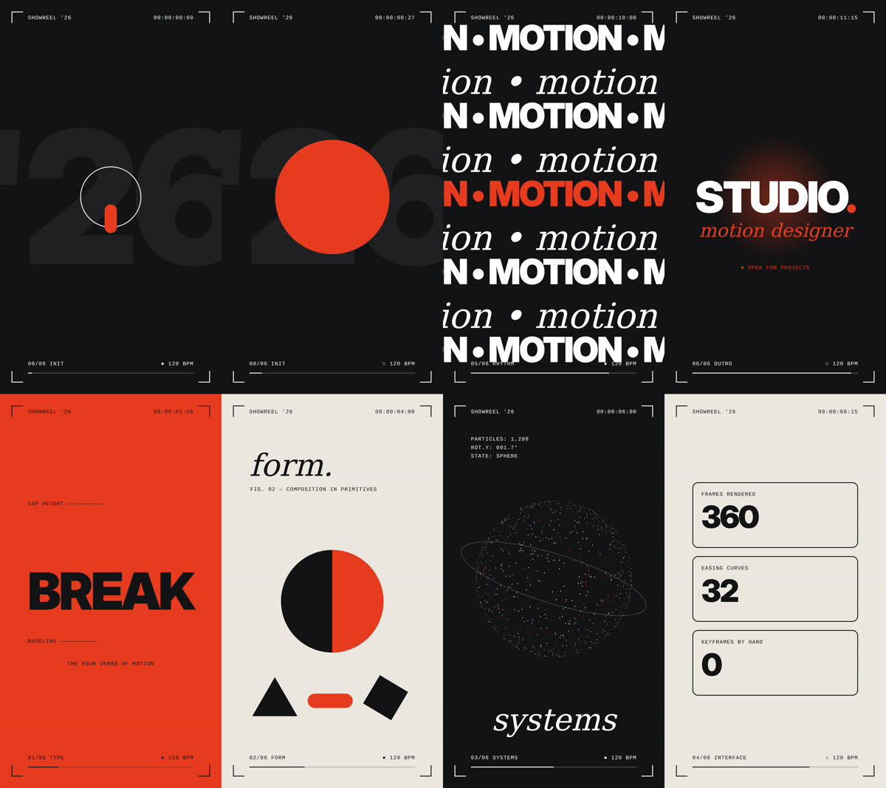

# Social Marketing — Ghania Ayunda

Paket social marketing (TikTok + Instagram) untuk karakter **Ghania Ayunda**: karakter dewasa, niche OOTD, outfit tips, detail outfit, dan fashion diary dengan estetika feminin.

**Status:** semua materi masih **draft**. Belum ada yang diproduksi, dijadwalkan, atau diterbitkan. Belum ada visual yang dibuat.

## Isi paket

| File | Isi |
|---|---|
| [01-brief-dan-positioning.md](social-marketing/01-brief-dan-positioning.md) | Brief proyek, identitas karakter, positioning, pilar, dan seri konten |
| [02-kalender-7-hari.md](social-marketing/02-kalender-7-hari.md) | Rencana konten dan uji penawaran selama 7 hari |
| [03-paket-produksi.md](social-marketing/03-paket-produksi.md) | Dua video (naskah bertiming + shot list), satu carousel, satu set Stories, caption, dan prompt visual |
| [04-penawaran-monetisasi.md](social-marketing/04-penawaran-monetisasi.md) | Penilaian 7 jalur monetisasi, kartu penawaran, alur transaksi, dan draft pesan |
| [05-lembar-evaluasi.md](social-marketing/05-lembar-evaluasi.md) | Lembar pencatatan metrik, aturan keputusan, dan eksperimen minggu depan |

## Asumsi yang dipakai (ganti bila berbeda)

- Akun tahap awal. Belum ada analitik, akses affiliate, maupun katalog produk.
- Waktu produksi 6–8 jam per minggu, dikerjakan oleh satu kreator.
- Tanpa belanja alat baru. Hanya memakai aset milik sendiri atau aset berizin.
- Pasar Indonesia, bahasa Indonesia, zona waktu Asia/Jakarta.
- Foto referensi wajah/identitas Ghania **belum tersedia** di repo ini.

## Tiga hal yang perlu dilengkapi

1. **Kondisi akun:** handle, jumlah followers, dan analitik 28 hari terakhir (jika ada).
2. **Aset:** foto referensi Ghania (3–5 sudut), daftar outfit/produk yang dimiliki, dan hak penggunaan musik/footage.
3. **Target:** jalur pendapatan yang paling diminati (jasa konten atau affiliate), serta target dan periodenya.

## Batasan

- Tidak ada angka hasil, tren, atau syarat platform yang dikarang. Semua yang belum terverifikasi diberi label.
- Aturan disclosure konten AI, sponsor, dan affiliate di TikTok dan Instagram harus dicek ulang di sumber resmi sebelum mengunggah.
- Ghania adalah karakter AI/sintetis. Jangan menampilkan demonstrasi AI sebagai pengalaman pemakaian produk oleh manusia nyata.

---

# Skill — Reel Motion Studio

Skill eksklusif pembuatan motion video graphic vertikal, diturunkan dari analisis 6 reel Instagram referensi. Ada di [`skills/reel-motion-studio/`](skills/reel-motion-studio/SKILL.md).

| File | Isi |
|---|---|
| [SKILL.md](skills/reel-motion-studio/SKILL.md) | Alur kerja, kontrak render, aturan, dan batasan |
| [analisis-6-reel.md](skills/reel-motion-studio/references/analisis-6-reel.md) | Analisis tiap reel dan pola bersama |
| [gaya-dan-resep.md](skills/reel-motion-studio/references/gaya-dan-resep.md) | Resep produksi 5 gaya (A–E) |
| [timing-easing-audio.md](skills/reel-motion-studio/references/timing-easing-audio.md) | Grid BPM, easing, peta sound design |
| [hud-showreel.html](skills/reel-motion-studio/templates/hud-showreel.html) | Template gaya A yang sudah teruji |
| [render.mjs](skills/reel-motion-studio/scripts/render.mjs) | Renderer HTML → MP4/PNG (Playwright + ffmpeg) |

Pasang sebagai skill: zip folder `skills/reel-motion-studio` lalu unggah di pengaturan Skills claude.ai, atau salin ke `~/.claude/skills/` untuk Claude Code.
